<div align="center">



<a href="https://supunchathuranga.se/">
  
</a>

<br/>


<a href="https://github.com/IamSupun?tab=followers"></a>
<a href="#-hackathon-trophy-wall"></a>

<br/>

<a href="https://supunchathuranga.se/"></a>
<a href="https://blog.supunchathuranga.se/"></a>
<a href="https://www.linkedin.com/in/supunchathuranga-ai/"></a>
<a href="mailto:chathurangarulz@gmail.com"></a>

</div>

---

## 🧠 `whoami`

```python
class Supun(Engineer):
    role       = "Lead AI Engineer @ SISP · Sweden Startup Next"
    location   = "Stockholm, Sweden 🇸🇪"
    focus      = ["Agentic AI systems", "Autonomous software factories", "MCP servers", "LLM & data pipelines"]
    experience = "8+ years · banking → energy → AR/VR → AI agents"
    education  = {
        "MSc Strategic Information Systems Management": "Stockholm University",
        "MSc Computer Science":                         "University of Colombo School of Computing",
        "BSc Information Technology":                   "SLIIT",
    }
    awards     = "2× 1st place · 10 top-5 hackathon finishes · Impact Cup 2026 finalist"

    def mission(self):
        return "Turn LLMs into agents that ship real work: reliably, observably, at scale."
```

- 🏭 Leading agentic development and an **autonomous software factory** that takes triaged issues to reviewed, merged PRs
- 🔌 Building **MCP servers** that let AI agents operate real infrastructure
- 🏠 Solo founder of **Hyreskoll**, a free tool that scores Swedish rental ads for scam risk (Impact Cup 2026 finalist)
- ✍️ Writing **[AI Weekly](https://blog.supunchathuranga.se/)**: fresh AI news every week plus deep dives
- 💬 Ask me about **LLM agents, MCP, context engineering, Python, TypeScript, React / React Native**

---

## 🏆 Hackathon trophy wall

<div align="center">

| | Project | Event | Built with |
|:--:|---|---|---|
| 🥇 | **[ASAP-RL](https://github.com/IamSupun/kong-rate-limiter-mcp-server)**: self-healing API rate limiter with ML anomaly detection | Kong AI-Assisted Enterprise Coding · Kong × KTH · 2025 | `Kong` `ML` `Docker` |
| 🥇 | **[SocialPilot](https://github.com/IamSupun/Social-Pilot)**: AI social media automation across LinkedIn, X and more | Kolomolo Hackathon · 2025 | `Gemini` `Temporal` |
| 🥈 | **[Legacy Java Upgrader](https://github.com/IamSupun/agentic-ai-modernizer)**: agentic Java 8 → 17 modernization | Agentic AI Software Modernization · Nordcloud (IBM) × AWS · 2025 | `Amazon Q` `n8n` |
| 🥈 | **[Unbroken](https://github.com/IamSupun/Unbroken-Logistics)**: disaster-resilient, offline-first logistics | Couchbase Disaster Resilience · AWS Sweden · 2025 | `Couchbase` |
| 🥈 | **Cloud Security CTF**: real-world cloud misconfigurations | Wiz Capture the Flag · Accenture · 2025 | `Cloud Security` |
| 🥉 | **[InfoLens](https://github.com/IamSupun/infolens)**: real-time client insights for PwC consultants | Proxify AI Business Value Hackathon · 2025 | `LLMs` `Dashboards` |
| 🥉 | **[Intelligent Dev Platform](https://github.com/IamSupun/intelligent-developers-platform)**: XGBoost predicts breaking changes (85% acc.) | AI-Powered Observability · HiQ × Grafana Labs · 2025 | `Grafana` `XGBoost` |
| 🚀 | **Hyreskoll**: rental-scam risk scoring for Sweden, 1 of 6 finalists from 45+ | Impact Cup 2026 · Drivhuset × Stockholm University | `AI` `Solo founder` |

<sub>Plus 4th place at Epiroc × Microsoft and Google Cloud AI, 5th at Elements Stockholm and the Generative AI Hackathon (<a href="https://github.com/IamSupun/Server-Mind">ServerMind MCP</a>), and a CEB Innovation bronze. <a href="https://supunchathuranga.se/">See all 13 →</a></sub>

</div>

---

## ⚡ Tech arsenal

<div align="center">

**AI & Agents**


<br/><br/>

**Languages & frameworks**

<a href="https://skillicons.dev"></a>

**ML, cloud & data**

<a href="https://skillicons.dev"></a>

</div>

---

## 🚀 Featured builds

<table>
<tr>
<td width="33%" valign="top">

### 🤖 [Agentic AI Modernizer](https://github.com/IamSupun/agentic-ai-modernizer)
Automated pipeline that modernizes legacy Java apps, orchestrated with **n8n**, **Amazon Q Developer** and AI analysis tools. 🥈 Nordcloud × AWS.

`Python` `n8n` `Docker`

</td>
<td width="33%" valign="top">

### 🔌 [Kong Rate Limiter MCP](https://github.com/IamSupun/kong-rate-limiter-mcp-server)
An **MCP server** that lets AI agents manage Kong API Gateway in plain language: rate limits, routes and policies. 🥇 Kong × KTH.

`Python` `MCP` `Kong`

</td>
<td width="33%" valign="top">

### 🧩 [ACE Context Engine](https://github.com/IamSupun/ace-context-engine)
Turns messy, unstructured information into clean, reusable **context documents for AI agents**. Context engineering on autopilot.

`Python` `LLMs` `Context`

</td>
</tr>
</table>

---

## ✍️ Writing & research

<table>
<tr>
<td width="50%" valign="top">

**📰 [AI Weekly on my blog](https://blog.supunchathuranga.se/)**
<br/><sub>Fresh AI news every week, plus deep dives on agents, cloud and systems.</sub>

- [AI Weekly: Gemini Hydrogen, Claude Self-Hosting and ChatGPT Wallet](https://blog.supunchathuranga.se/)
- [AI This Week: OpenAI Targets Git, Meta Buys Conductor, Qwen Reaches iPhones](https://blog.supunchathuranga.se/)
- [AI Weekly: Kimi K3.1, DeepSeek Agents and OpenAI's Linux Security Push](https://blog.supunchathuranga.se/)

</td>
<td width="50%" valign="top">

**🎓 Research**

- [Organizational Cultural Values that Enable Digital Transformation in an IT Company in Sweden](https://www.researchgate.net/publication/415538623) · <sub>Master's thesis, Stockholm University, 2026</sub>
- [Forecasting the Stock Market Performance Using External Factors: In the Sri Lankan Context](https://www.researchgate.net/publication/417381811) · <sub>Machine learning</sub>

<a href="https://orcid.org/0009-0008-3048-871X"></a>

</td>
</tr>
</table>

---

## 📊 GitHub in numbers

<div align="center">



<sub>Counts every year since 2016, including private company work: numbers only, no repo names or code are shown. Updated daily.</sub>

<br/><br/>



</div>

---

## 🐍 Watch the snake eat my contributions

<div align="center">
<picture>
  <source media="(prefers-color-scheme: dark)" srcset="https://raw.githubusercontent.com/IamSupun/IamSupun/output/snake-dark.svg"/>
  <source media="(prefers-color-scheme: light)" srcset="https://raw.githubusercontent.com/IamSupun/IamSupun/output/snake-light.svg"/>
  
</picture>
</div>

---

## 🤝 Let's build something

<div align="center">

<a href="https://supunchathuranga.se/"></a>
<a href="https://blog.supunchathuranga.se/"></a>
<a href="https://www.linkedin.com/in/supunchathuranga-ai/"></a>
<a href="mailto:chathurangarulz@gmail.com"></a>

<br/><br/>

⭐ **If something here sparked an idea, star a repo or follow along. New agents ship often.** ⭐

<sub>🎨 Design by <a href="https://github.com/IamSupun">Supun Chathuranga</a> · © 2026 · <a href="./LICENSE">All rights reserved</a></sub>


</div>
